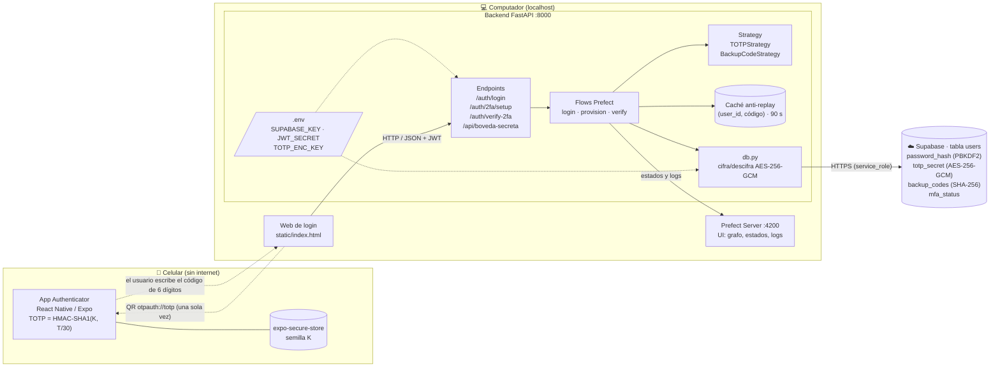
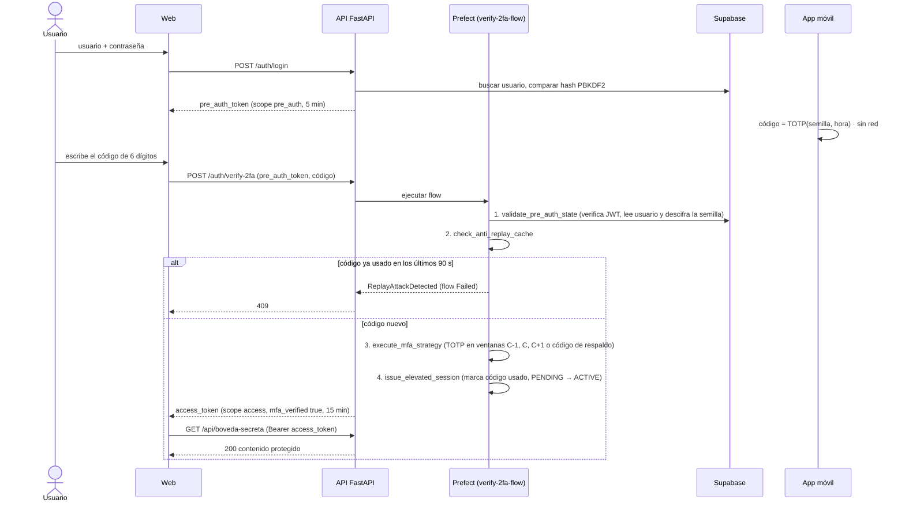

# 2FA TOTP desde cero + Step-Up Auth + Observabilidad con Prefect

```
/mobile-authenticator   App React Native (Expo) que calcula TOTP sin conexión (RFC 6238 hecho a mano)
/backend-prefect        FastAPI + Prefect + Supabase, incluye la web de login (static/index.html)
```

## Arquitectura



La app y el backend **nunca se comunican**. Comparten la semilla una sola vez (por el QR) y después cada uno calcula el mismo código a partir del reloj.

### Flujo Step-Up (login + segundo factor)



| Patrón | Dónde |
|---|---|
| **Step-Up Auth** | `POST /auth/login` → `pre_auth_token` (scope `pre_auth`, 5 min, no abre recursos). `POST /auth/verify-2fa` → `access_token` con `mfa_verified: true`. `GET /api/boveda-secreta` exige este último. (`security.py`, `main.py`) |
| **Process Manager / Estados** | `DISABLED → PENDING_VERIFICATION` al generar el QR; `PENDING_VERIFICATION → ACTIVE` solo con el primer código válido. Con 2FA `ACTIVE` no se puede re-aprovisionar. (`flows.py`) |
| **Strategy** | `SecondFactorStrategy` con `TOTPStrategy` (ventanas C-1, C, C+1) y `BackupCodeStrategy` (8 códigos de un solo uso, guardados como SHA-256). (`strategies.py`) |
| **Anti-Replay** | Caché en memoria `(user_id, código)` con TTL de 90 s. (`flows.py`) |
| **Secreto cifrado en reposo** | `totp_secret` se guarda en Supabase cifrado con **AES-256-GCM** (`v1:...`), con el `id` del usuario como dato asociado. La clave `TOTP_ENC_KEY` solo vive en el `.env`. (`db.py`) |

Flows de Prefect: `login-flow`, `provision-2fa-flow` y `verify-2fa-flow`. Este último tiene las 4 tareas de la guía:
`validate_pre_auth_state → check_anti_replay_cache → execute_mfa_strategy → issue_elevated_session`.
Contraseñas y tokens se pasan como `SecretStr`, así que la UI de Prefect los muestra enmascarados. Las tareas no usan caché ni guardan resultados.

## 1. Supabase

1. Crea un proyecto en https://supabase.com.
2. En el **SQL Editor**, ejecuta `backend-prefect/schema.sql`.
3. En **Project Settings → API**, copia la `Project URL` y la clave `service_role`.

## 2. Backend + Prefect (Windows)

Comandos para **CMD**. En PowerShell, cambia `.venv\Scripts\activate.bat` por `.\.venv\Scripts\Activate.ps1`. Tras activar, el prompt debe empezar con `(.venv)`.

```bat
cd backend-prefect
py -m venv .venv
.venv\Scripts\activate.bat
pip install -r requirements.txt
copy .env.example .env
```

Luego abre `.env` y rellena `SUPABASE_URL`, `SUPABASE_KEY`, `JWT_SECRET` y `TOTP_ENC_KEY`.
`SUPABASE_URL` debe ser solo `https://<proyecto>.supabase.co`, **sin** `/rest/v1` al final.
Para generar `TOTP_ENC_KEY` (clave AES-256):

```bat
py -c "import os,base64;print(base64.b64encode(os.urandom(32)).decode())"
```

> Si pierdes `TOTP_ENC_KEY`, las semillas guardadas no se pueden descifrar y los usuarios deben volver a escanear el QR. Si tenías semillas guardadas en texto plano de una versión anterior, cífralas una vez con `python encrypt_existing_secrets.py`.

Terminal 1, servidor de Prefect (UI en http://127.0.0.1:4200):

```bat
cd backend-prefect
.venv\Scripts\activate.bat
prefect server start
```

Terminal 2, API + web:

```bat
cd backend-prefect
.venv\Scripts\activate.bat
uvicorn main:app --host 0.0.0.0 --port 8000
```

Abre http://localhost:8000 para la web de login y http://localhost:8000/docs para Swagger.

Autoprueba del algoritmo TOTP con los vectores de la RFC 6238: `python strategies.py`

## 3. App móvil (Expo)

```bat
cd mobile-authenticator
npm install
npx expo install --fix
npm test           # vectores RFC 6238 / RFC 2202
npx expo start     # escanea el QR de Expo con Expo Go, o pulsa "a" para el emulador Android
```

La app guarda la semilla en `expo-secure-store` y no hace ninguna llamada de red, así que funciona en modo avión.
En el emulador (sin cámara), pega la semilla Base32 que muestra la web.

## Guion de la demo

1. **Paridad**: en la web, regístrate (usuario o correo) → inicia sesión → **Generar código QR**. Escanea el QR con esta app y con Google/Microsoft Authenticator: las dos muestran el mismo código.
2. **Modo avión**: activa el modo avión, espera a que cambie la ventana de 30 s, pulsa **Ya lo escaneé, continuar**, escribe el código (el estado pasa a `ACTIVE`) → **Abrir /api/boveda-secreta**.
3. **Replay**: en la tarjeta *Acceso concedido*, pulsa **Reenviar el mismo código** → HTTP 409 `ReplayAttackDetected`. En Prefect, `verify-2fa-flow` aparece **Failed** en `check_anti_replay_cache`.
4. **Desfase de reloj / respaldo**: el log de `execute_mfa_strategy` indica la ventana (`C-1`, `C` o `C+1`) donde coincidió el código. También puedes pulsar *Usar un código de respaldo* y usar uno de los 8 códigos.

> El QR solo se muestra mientras el 2FA no está `ACTIVE`. Para repetir la demo de paridad, reinícialo en Supabase:
> `update users set mfa_status = 'DISABLED' where username = '<tu usuario>';`

## Problemas comunes

| Síntoma | Causa y solución |
|---|---|
| `"pip" no se reconoce...` | Estás en CMD y usaste `Activate.ps1`. Usa `.venv\Scripts\activate.bat`. |
| `Error 500` al registrarse | `SUPABASE_URL` termina en `/rest/v1`. Quítalo y reinicia uvicorn. |
| uvicorn se cierra sin mensaje | El puerto 8000 está ocupado por otro uvicorn. Ciérralo o usa `--port 8001`. |

## Límites (PoC)

- La caché anti-replay vive en el proceso: ejecuta uvicorn con un solo worker. Con varios workers haría falta Redis (`SET NX EX 90`).
- Sin rate limiting en `/auth/verify-2fa`. Para producción, conviene bloquear tras N intentos fallidos.

---

## Cumplimiento de la rúbrica

### 1. Implementación criptográfica TOTP en la app móvil (30%)

> *La app calcula el código de 6 dígitos desde cero (HMAC-SHA1 + truncamiento dinámico) cada 30 s sin conexión y coincide con Google/Microsoft Authenticator.*

- **Sin librerías TOTP.** [mobile-authenticator/totp.js](mobile-authenticator/totp.js) no usa `otplib`, `speakeasy` ni equivalentes. La guía permitía usar librerías para HMAC-SHA1 y Base32, pero aquí **también se escribieron a mano**:
  - `base32Decode`: decodifica la semilla a bytes `K`.
  - `sha1` y `hmacSha1`: SHA-1 (FIPS 180) y HMAC (RFC 2104) completos.
  - `hotp`: empaqueta `C` como entero de 8 bytes Big-Endian, calcula `HMAC-SHA1(K, C)`, toma `offset = hash[19] & 0x0f`, extrae 4 bytes, aplica `& 0x7f` al primero, `% 1000000` y rellena con ceros.
  - `totp`: `C = floor(UnixTime / 30)`.
- **Ingesta del secreto** ([App.js](mobile-authenticator/App.js)):
  - escaneo del QR con `expo-camera`, extrayendo `secret` de la URI `otpauth://totp/...`;
  - o un campo de texto para pegar la semilla Base32 (útil en el emulador).
  - La semilla se guarda en el almacenamiento cifrado del sistema (`expo-secure-store`).
- **Interfaz:** código de 6 dígitos en grande, barra de progreso y cuenta regresiva de 30 a 0 s, y regeneración automática al cambiar la ventana. Se muestra también el contador `C` actual.
- **Sin conexión:** la app no hace ninguna llamada de red, así que funciona en modo avión.
- **Verificación:** `npm test` ([totp.test.mjs](mobile-authenticator/totp.test.mjs)) compara contra los vectores oficiales de la RFC 6238 (T = 59, 1111111109, 1234567890, 2000000000, 20000000000) y de la RFC 2202 (HMAC-SHA1). Al pasar los vectores del estándar, el código coincide con Google/Microsoft Authenticator (prueba de paridad de la demo).

### 2. Patrones arquitectónicos: Step-Up, Strategy, Estado (30%)

> *Estado `PENDING_VERIFICATION`, separación entre pre-auth token y access token, y patrón Strategy para el segundo factor.*

- **Máquina de estados / Process Manager** ([flows.py](backend-prefect/flows.py), columna `mfa_status` en [schema.sql](backend-prefect/schema.sql)):
  - `DISABLED → PENDING_VERIFICATION`: `provision-2fa-flow` genera una semilla de 160 bits y 8 códigos de respaldo, y deja la configuración pendiente.
  - `PENDING_VERIFICATION → ACTIVE`: solo cuando llega el **primer código válido** (`issue_elevated_session`). Si el usuario genera el QR y nunca lo escanea, su cuenta no queda bloqueada.
  - Con 2FA `ACTIVE` no se puede re-aprovisionar: quien solo tenga la contraseña no puede registrar su propio teléfono.
  - Cada transición queda en los logs de Prefect (`Transición de estado: X -> Y`).
  - La base de datos solo admite esos tres estados (`check` en `schema.sql`).
- **Step-Up Authentication** ([security.py](backend-prefect/security.py), [main.py](backend-prefect/main.py)):
  - `POST /auth/login` devuelve **solo** un `pre_auth_token` (JWT con `scope: "pre_auth"`, válido 5 min). Ese token solo sirve para `/auth/2fa/setup` y `/auth/verify-2fa`.
  - `POST /auth/verify-2fa` devuelve el `access_token` (`scope: "access"`, `mfa_verified: true`, 15 min).
  - `GET /api/boveda-secreta` rechaza el `pre_auth_token` (401) y exige `mfa_verified: true` (403 si falta).
- **Strategy Pattern** ([strategies.py](backend-prefect/strategies.py)):
  - Clase base abstracta `SecondFactorStrategy` con el método `verify(user, code, logger)`.
  - `TOTPStrategy`: valida el código en las ventanas `C-1`, `C` y `C+1`, con comparación de tiempo constante (`hmac.compare_digest`).
  - `BackupCodeStrategy`: 8 códigos de emergencia de un solo uso. Se guardan como hash SHA-256 y se borran al usarse.
  - Las estrategias son intercambiables: `execute_mfa_strategy` elige la estrategia en el diccionario `STRATEGIES` según el campo `method` (`"totp"` o `"backup"`), sin `if` por tipo.
- **Protección de secretos en la base de datos:**

  | Dato | Protección | Por qué |
  |---|---|---|
  | Contraseña | Hash PBKDF2-SHA256, 200 000 iteraciones, sal aleatoria | Solo hay que compararla, nunca recuperarla |
  | Códigos de respaldo | Hash SHA-256 | Igual: solo se comparan |
  | Semilla TOTP | **Cifrado AES-256-GCM** ([db.py](backend-prefect/db.py)) | El servidor necesita el valor original para calcular el HMAC, así que no puede ser un hash. Se cifra al escribir y se descifra al leer, dentro de `db.py`, así que ninguna otra parte del código puede guardarla en claro. GCM detecta cualquier alteración, y el `id` del usuario va como dato asociado: una semilla cifrada copiada a otra fila no se descifra. |

  La clave `TOTP_ENC_KEY` y la `service_role` de Supabase solo viven en el `.env` del backend. La tabla tiene RLS activado sin políticas públicas. RLS solo controla quién accede a la tabla; si la base de datos se filtrara, el cifrado hace que las semillas sigan sin poder usarse.

### 3. Idempotencia y prevención de replay attacks (15%)

> *Un código válido no puede usarse dos veces dentro de la misma ventana de validez.*

- **`check_anti_replay_cache`** ([flows.py](backend-prefect/flows.py)): consulta una caché en memoria con clave `(user_id, código)`. Si el par se usó en los **últimos 90 s**, lanza `ReplayAttackDetected` y el endpoint responde **HTTP 409**.
- **Por qué 90 s:** cubre la ventana completa de aceptación (C-1, C y C+1 = 3 × 30 s). Así, un código no puede reutilizarse mientras siga siendo matemáticamente válido.
- **`issue_elevated_session`** marca el código como usado **solo después** de que la estrategia lo valida. Un código erróneo no consume nada.
- **Códigos de respaldo:** además de la caché, son de un solo uso permanente, porque se borran de la base de datos.
- **Demo:** botón *Reenviar el mismo código* en la web.

### 4. Observabilidad y orquestación con Prefect (25%)

> *Pipeline decorado con `@flow` y `@task`, visible en la UI: grafo de ejecución, bloqueos por replay y logs de ventana temporal.*

- **Tres flows** ([flows.py](backend-prefect/flows.py)), uno por cada llamada a la API:

  | Flow | Endpoint | Tareas |
  |---|---|---|
  | `login-flow` | `POST /auth/login` | `verify_credentials` → `issue_pre_auth_token` |
  | `provision-2fa-flow` | `POST /auth/2fa/setup` | `validate_pre_auth_state` → `create_pending_configuration` → `build_provisioning_uri` |
  | `verify-2fa-flow` | `POST /auth/verify-2fa` | `validate_pre_auth_state` → `check_anti_replay_cache` → `execute_mfa_strategy` → `issue_elevated_session` |

- **Grafo de ejecución:** en la UI de Prefect (http://127.0.0.1:4200 → *Runs*), cada flow muestra sus tareas en orden.
- **Bloqueo por replay:** el flow queda **Failed** (rojo) exactamente en `check_anti_replay_cache`, con el mensaje `ReplayAttackDetected`.
- **Logs de ventana temporal** (`get_run_logger()` en `TOTPStrategy`):
  - `TOTP match en ventana C-1 (contador ..., actual ...)`
  - `Reloj del celular atrasado ~30s`, o adelantado si coincide en `C+1`.
- **Datos sensibles fuera de Prefect:** contraseñas y tokens se pasan como `SecretStr`, así que la UI los muestra como `**********`. Las tareas usan `NO_CACHE` y `persist_result=False`, para que Prefect no guarde semillas ni JWT en disco.

### Entregables

- [x] Repositorio con `/mobile-authenticator` y `/backend-prefect`.
- [x] Este README, con instrucciones para levantar Prefect (`prefect server start`), el backend y la app móvil.
- [x] Base de datos de usuarios en Supabase ([schema.sql](backend-prefect/schema.sql)).
- [x] Web de login ([backend-prefect/static/index.html](backend-prefect/static/index.html)).
